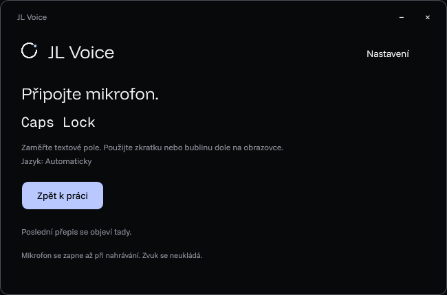

# JL Voice

Offline Czech and English dictation for Windows 11 x64. Designed first for ordinary 8 GB PCs with integrated graphics and modest CPUs; 16 GB is the secondary target. Dedicated graphics are optional, never required.

**Status: development preview source, not a release.** The unsigned ASR worker is currently blocked on the owner’s Windows 11 PC with Smart App Control enabled; [trusted signing is unresolved](docs/SIGNING.md). No representative 8 GB Windows hardware, real microphone, destination application, or Czech/English/mixed speech corpus has been qualified. Building successfully does not establish dictation quality or minimum hardware support.

[Windows CI](https://github.com/beamj786-rgb/jl-voice/actions/runs/45022584983) passed at `2b67c1a`: self-contained CPU package build, 13 PCM/hold-key/settings checks, ten scoring/native-boundary tests, a public English CPU transcription fixture, tray startup/idle monitoring and WPF UI review. Hosted Windows CI is not representative Windows 11 low-end hardware.

## Implemented

- WPF/XAML tray application without a browser engine; reactive, nonactivating bottom-centre dictation bubble.
- Static idle capsule, hover shortcut/settings, real PCM audio meter, processing feedback and cancellation with Escape or the bubble. Closing the window keeps it in the tray; Exit shuts it down.
- Hold Caps Lock to record and release to transcribe (fresh-install default). The key is consumed while configured, preserving its previous letter-case state. F9–F12 remain selectable for hold or Ctrl+Alt+key toggle mode; existing saved shortcuts are preserved.
- Microphone selection; mono 16 kHz PCM capture only during explicit recording, bounded to 90 seconds per recording in this preview.
- Czech, English, and experimental Automatic language selection.
- Isolated, below-normal-priority native whisper.cpp CPU worker with at most two inference threads, GPU explicitly disabled, five-minute timeout and cancellation.
- Audio sent through an anonymous pipe, no audio files or persistent transcript history by default. Last result stays in memory until the next recording or exit.
- Unicode keyboard insertion with an original-window check, without changing the clipboard. Input dispatch still needs real target-app acceptance testing.
- Worker exits after each dictation, releasing model memory. No prewarming, idle inference, or resident LLM.
- Portable settings, pinned model download hashes, Windows packaging script and developer benchmark tools.
- JL Automation WPF UI: bundled Funnel Display / Funnel Sans / Geist Mono, original Orbit assets, dark/light/system themes, Czech/English interface, minimal main window and settings with advanced options. See [UI design and review](docs/UI.md).



WPF UI checks cover bundled fonts, dark/light themes, eight page/viewport states down to 540 × 440, bubble focus preservation, Stop/Cancel actions and return to static idle. The screenshot is from a hosted Windows runner without a microphone. [Screenshots and review limits](docs/UI.md#verified-review--2026-11-21).

Automatic mode currently uses upstream language detection for the recording, **not verified language switching within one recording**. No candidate model has passed Czech/English quality acceptance; the small quantized base model is an experiment, not an accuracy claim.

## Try a Windows test build

An owner/developer can manually run **Actions → Development build checks → Run workflow**, enable **Upload a portable Windows test package after checks pass**, and download `JLVoice-Windows-x64-test` from the successful run. Extract the whole artifact into a new writable folder and launch `JLVoice.exe`. The runtime, CPU worker, model and fonts are included; no SDK, Python or separate model installation is needed. This is an unsigned temporary development artifact, not a production release. Ordinary pushes upload only UI/measurement evidence.

See [the portable testing guide](docs/TESTING.md) for Czech/English/mixed-speech checks, bubble/cancellation/focus tests, offline verification and a short bug report template. Testing on a 16 GB PC does not qualify the primary 8 GB target.

## Developer build

Use .NET SDK 10.0.404 (or compatible patch), PowerShell 7, Git, CMake and Visual Studio C++ build tools on Windows. These are build-machine requirements, not end-user dependencies.

```powershell
dotnet build src/JLVoice/JLVoice.csproj -c Release
pwsh scripts/package.ps1
```

`artifacts/JLVoice` is a self-contained portable folder, including the CPU runtime and multilingual model. Do not distribute it until licenses, clean-machine/offline operation and the [acceptance checklist](docs/REQUIREMENTS.md) pass. The development package downloads dependencies only at build time. The application contains no model downloader, cloud ASR, account system or telemetry.

Launch `JLVoice.exe`, focus a text field, hold Caps Lock to speak and release it to transcribe. Existing saved shortcuts keep their previous binding. The bottom-centre bubble can also start/stop recording; hovering reveals settings. Double-click the tray icon to open the main window. Escape cancels active dictation. Closing/minimizing keeps the app in the tray; use Exit in the tray menu to quit. Keep the portable folder writable for settings. Elevated applications and some input controls may reject synthesized input; inspect the retained result rather than blindly retrying partial insertion.

The three candidate models can be packaged with `-Model ggml-base-q5_1.bin`, `ggml-base-q8_0.bin`, or `ggml-small-q5_1.bin`. Packaging a larger candidate is an explicit developer choice, not an automatic RAM-based upgrade.

See [benchmarks](docs/BENCHMARKS.md), [architecture](docs/ARCHITECTURE.md), [research](docs/REVERSE_ENGINEERING.md) and [known issues](docs/KNOWN_ISSUES.md).
