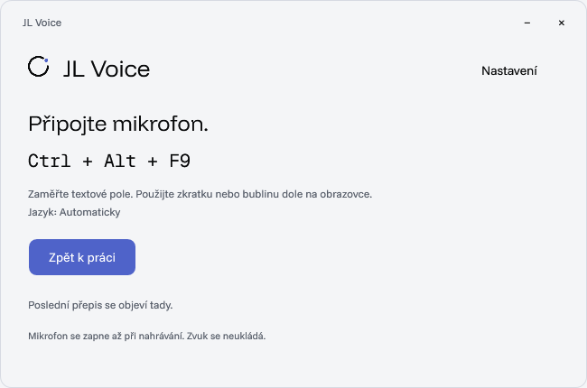
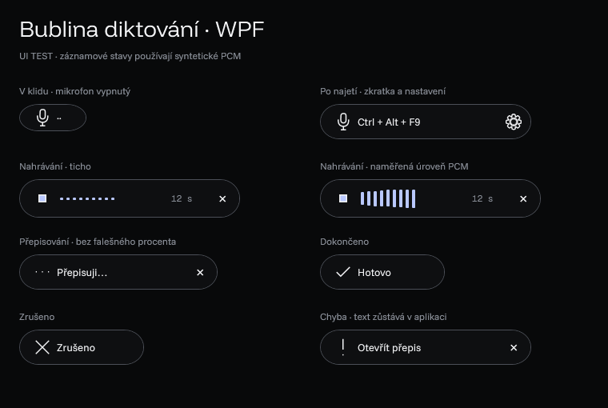

# JL Voice WPF interface and JL Automation identity

## Source and scope

The owner requested the JL Automation colours and fonts for the native desktop UI. Visual tokens were checked against JL Workspace's company context (Brand book v1, November 2026) and the matching public source at `beamj786-rgb/JL-Automation-Agency`, commit `d372171f3b6a9b05be993ee884842197f5a38576`, `jl-workspace/brand.mjs` and `jl-workspace/public/fonts/fonts.css`.

The original Orbit marks and app icon are reused without recolouring, rotation or effects. PNG/ICO files are raster exports of those SVG assets. The packaged font files are the existing static brand files, not approximations or remote font requests. OFL license texts accompany each font.

| Role | Value |
|---|---|
| Dark background | Black `#08090a` |
| Input surfaces | Surface 1 `#0e0f11`, Surface 2 `#141518` |
| Primary / secondary text | Ink `#f2f3f5`, Dim `#8a8f98` |
| Accent / subtle borders | Signal `#b9c8ff`, Faint `#4b4f57` |
| Light background / accent | Paper `#f4f5f7`, Signal ink `#4f63c9` |
| Headings | Funnel Display Light, 300 |
| UI, body and buttons | Funnel Sans, 400 |
| Shortcuts and interface labels | Geist Mono, 400 |

White light-mode input surfaces and the supporting light greys (`#eceef2`, `#535a66`, `#d6dae2`) are desktop UI extensions, not additional original brandbook tokens. Windows high-contrast colours override decorative brand colours for readability.

## Interaction

- **Main window:** one status, shortcut, saved language and a single Back to work action. No sidebar or summary cards. The last transcript and its Copy/Clear actions appear only after recognition produces text; failed insertion preserves it in memory.
- **Bottom-centre bubble:** a small, static microphone capsule while idle. Hover expands it to show the shortcut and Settings. Clicking starts recording without activating the bubble or moving the native text-field focus. A saved preference disables idle visibility; its context menu and tray menu also support hiding it for the current session.
- **Recording:** stop button, elapsed time, nine bars derived from captured PCM RMS, and Cancel. Silence produces a flat meter. The 50 ms capture display timer runs only during recording; it does not open the microphone itself.
- **Processing:** indeterminate feedback, no invented percentage, with Cancel. Escape is registered only during recording/processing. Motion follows the Windows client-animation preference. Completion/cancellation clears itself after 1.5 seconds; an error remains available to open the retained transcript or details.
- **Placement and focus:** bottom centre of the target monitor's working area, above the taskbar. Placement responds to display/DPI events instead of idle polling. Native `WS_EX_NOACTIVATE`, `MA_NOACTIVATE` and `SWP_NOACTIVATE` preserve focus. WPF `ShowActivated=false` and nonfocusable bubble buttons prevent managed activation.
- **Settings:** language, microphone refresh, shortcut/hold mode, idle visibility, theme and UI language. Model and bounded CPU-thread settings are behind Advanced options. Changes save explicitly; appearance/language preview immediately. Czech/English interface is separate from Czech/English/Automatic ASR selection.
- **Window lifecycle:** closing or minimizing hides to the tray and reveals the bubble. Exit in the tray menu actually shuts down, cancelling owned work first. Opening the main window hides the bubble.
- **Themes/accessibility:** bundled, process-private JL Automation fonts; dark/light/system and Windows high-contrast palette. WPF settings controls retain tab navigation and focus outlines. WPF button automation peers expose bubble action names and Invoke patterns. Physical DPI, multi-monitor and assistive-technology acceptance remain separate checks.

No microphone, inference, meter timer or animation timer runs while idle. The bubble is a projection of controller state, not an audio owner. The UI uses software rendering, with no browser renderer, resident model or GPU rendering context.

## Review procedure

On Windows, `JLVoice.exe --ui-review NEW_OUTPUT_DIRECTORY` produces WPF `RenderTargetBitmap` screenshots, font/layout checks, keyboard navigation checks, a focused WPF text-field probe, native mouse-activation checks and automation invocation of bubble actions, timer-reset checks and close-to-tray verification. Review mode does not record audio, run ASR, register hotkeys, save settings or read user transcripts. The recording-state board is explicitly labelled as a synthetic-PCM UI fixture.

CI uploads review images and developer measurement metadata, not an application release. Rendering and same-process native focus checks do not prove behavior in external applications or physical DPI/screen-reader acceptance. Inspect the generated images before claiming visual verification.

## Verified review — 2026-11-21

[Windows CI run 44958178106](https://github.com/beamj786-rgb/jl-voice/actions/runs/44958178106), source commit `c45f7c586819a2ca0669f3b67db56875ebe32d8a`, passed self-contained package creation, five PCM checks, ten scoring/native-boundary tests, the public English CPU fixture, tray startup/idle monitoring and WPF UI review.

All nine final screenshots were visually inspected. The [render report](ui-review/review.json) confirms all three bundled fonts loaded, no horizontal page overflow, keyboard traversal, repeated nonactivating bubble show, focus preservation across all eight bubble states and automation invocation of Start/Stop/Cancel. The 1.5-second completion timer actually returned to static idle and cleared its meter. Close-to-tray was exercised. These checks use a same-process focused WPF text box; external applications remain a separate acceptance boundary.

Eight page/viewport renders cover Czech dark/light main windows at 650 × 430 and settings at 650 × 650, an authored transcript fixture at 650 × 620, and English compact main/settings/top-and-bottom at 540 × 440. The custom WPF chrome is included. The settings page scrolls vertically in the compact viewport; controls and fields retain their own focus cues.

| Dark main window | Light main window |
|---|---|
|  |  |

[Dark settings](ui-review/dark-settings.png) · [Light settings](ui-review/light-settings.png) · [Compact settings, top](ui-review/compact-english-settings.png) · [Compact settings, bottom](ui-review/compact-english-settings-bottom.png) · [Authored transcript fixture](ui-review/transcript-fixture.png).

The bubble board uses synthetic PCM, and the transcript image contains authored test text. Neither is evidence of microphone capture or speech-recognition accuracy. Main-window screenshots show the runner's actual no-microphone state.

The [raw idle probe](ui-review/idle-ci.json) ran for 12 seconds on Windows Server 2025, four logical CPUs and approximately 16 GB RAM, with the idle bubble visible and no loaded model. Steady sampled working set was 87.83 MiB, sampled peak 87.83 MiB, and observed launch-to-ready about 1081 ms. No CPU time was observed during the steady sampling window. The raw report preserves sampling/cache limitations. These are hosted-CI observations, **not representative 8 GB hardware qualification or a responsiveness guarantee**.

Still unverified: representative 8 GB Windows 11 hardware, physical DPI/monitor transitions, high-contrast and screen-reader acceptance, complete keyboard-only workflows, microphone-to-external-target insertion and the mandatory Czech/English/mixed-language speech suite. No application release has been published.
