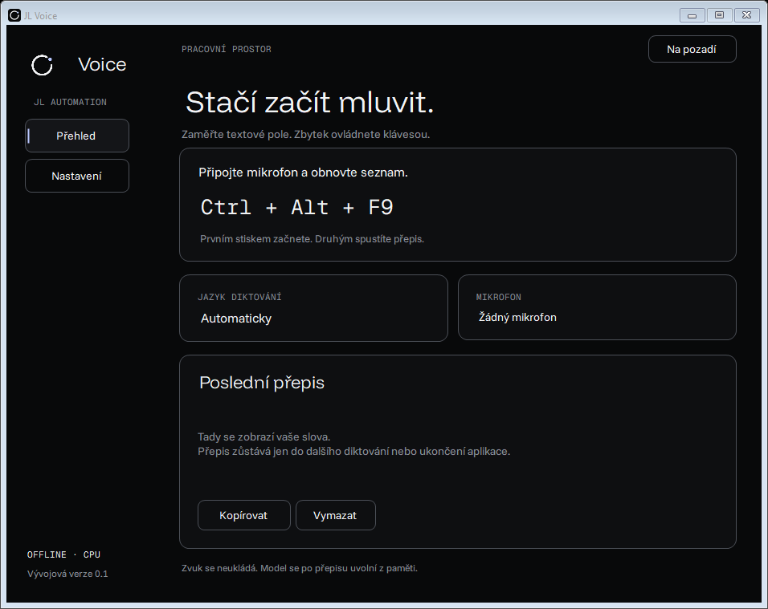

# JL Automation visual identity in JL Voice

## Source and scope

The owner requested the JL Automation colours and fonts for the native desktop UI. Visual tokens were checked against JL Workspace's company context (Brand book v1, November 2026) and the matching public source at `beamj786-rgb/JL-Automation-Agency`, commit `d372171f3b6a9b05be993ee884842197f5a38576`, `jl-workspace/brand.mjs` and `jl-workspace/public/fonts/fonts.css`.

The original Orbit marks and app icon are reused without recolouring, rotation or effects. PNG/ICO files are raster exports of those SVG assets. The packaged font files are the existing static brand files, not approximations or remote font requests. OFL license texts accompany each font.

| Role | Value |
|---|---|
| Dark background | Black `#08090a` |
| Cards / input surfaces | Surface 1 `#0e0f11`, Surface 2 `#141518` |
| Primary / secondary text | Ink `#f2f3f5`, Dim `#8a8f98` |
| Accent / subtle borders | Signal `#b9c8ff`, Faint `#4b4f57` |
| Light background / accent | Paper `#f4f5f7`, Signal ink `#4f63c9` |
| Headings | Funnel Display Light, 300 |
| UI, body and buttons | Funnel Sans, 400 |
| Shortcuts and interface labels | Geist Mono, 400 |

White light-mode cards and the supporting light greys (`#eceef2`, `#535a66`, `#d6dae2`) are desktop UI extensions, not additional original brandbook tokens. Windows high-contrast colours override decorative brand colours for readability.

## Interaction

- **Overview:** current status, saved shortcut, selected microphone/language and the in-memory last transcript. Copy is an explicit user action; automatic insertion still leaves the clipboard untouched. Clear removes only the last in-memory result.
- **Settings:** speech language, microphone refresh, bundled model selection, 1–2 CPU threads, key/hold mode, theme and UI language. Czech/English interface language is separate from Czech/English/Automatic ASR selection. Changes are saved explicitly; appearance/language preview immediately.
- **Themes:** dark, light and system. System appearance changes use Windows events, not polling. Fonts are loaded process-privately from the portable folder; no OS installation or network is required.
- **Recording overlay:** nonactivating native window, brand typography, recording/time and processing/CPU states. There is no fabricated waveform or continuously running idle animation.
- **Keyboard:** native controls, visible focus outlines, logical tab traversal and accessible field names. Compact windows scroll settings vertically. Physical DPI, multi-monitor, screen-reader and full keyboard acceptance remain separate checks.

The implementation keeps Windows Forms/native controls and a small set of GDI drawing operations. It does not add a web renderer, background inference or a GPU context. Font and mark caches are bounded and disposed at exit. Target-hardware resource acceptance remains outstanding.

## Review procedure

On Windows, run `JLVoice.exe --ui-review NEW_OUTPUT_DIRECTORY` on a development build to produce native `DrawToBitmap` screenshots, font-loading checks, compact viewport checks, navigation checks and a JSON layout report. This mode does not record audio, run ASR, register hotkeys, save settings or read user transcripts. Its overlay image is explicitly labelled as a UI test fixture.

CI uploads only these review screenshots and developer measurement metadata, not an application release. A native render check is not proof of physical DPI, assistive technology or target-application input behavior. Final visual review must inspect the actual generated images before claiming the redesign is verified.

## Verified review — 2026-11-21

[Windows CI run 44953296127](https://github.com/beamj786-rgb/jl-voice/actions/runs/44953296127), source commit `d9467e0998c47d2561d1cea17cd9f64668e891d6`, passed self-contained package creation, all ten scoring/native boundary tests, the public English CPU fixture, tray startup/idle monitoring and native UI review. All eight generated images were visually inspected after the final changes.

The [render report](ui-review/review.json) confirms all three bundled fonts loaded and no horizontal or vertical child clipping in seven page/viewport states: Czech dark/light overview and settings at 940 × 720 client size, plus English compact overview/settings/top-and-bottom at 720 × 480. Images include the OS window frame, so their outer dimensions are larger than the client viewport. Native control handles refresh when the palette changes, and cards use content-driven table layout to preserve all fields in a narrow viewport.

The screenshots show the actual hosted runner's state: it has no microphone attached. The overlay screenshot is an explicitly labelled rendering fixture, not a recording.

| Dark overview | Light overview |
|---|---|
|  |  |

[Dark settings](ui-review/dark-settings.png) · [Light settings](ui-review/light-settings.png) · [Compact settings, top](ui-review/compact-english-settings.png) · [Compact settings, bottom](ui-review/compact-english-settings-bottom.png).

The [raw idle probe](ui-review/idle-ci.json) was collected on Windows Server 2025, four logical CPUs and approximately 16 GB RAM, for 12 seconds, with no loaded model. The measured steady sampled working set was 67.85 MiB, sampled peak 69.16 MiB, launch-to-ready about 867 ms, and no CPU time was observed in the steady sampling window. Sampling, cache state and short-run limitations are preserved in the report. These values are hosted-CI observations, **not 8 GB hardware qualification or a responsiveness guarantee**.

Still unverified: real Windows 11 target hardware, 150/200% physical DPI and monitor transitions, high-contrast and screen-reader acceptance, complete keyboard-only workflows, microphone-to-target insertion and the mandatory Czech/English/mixed-language acceptance suite. No application release has been published.
